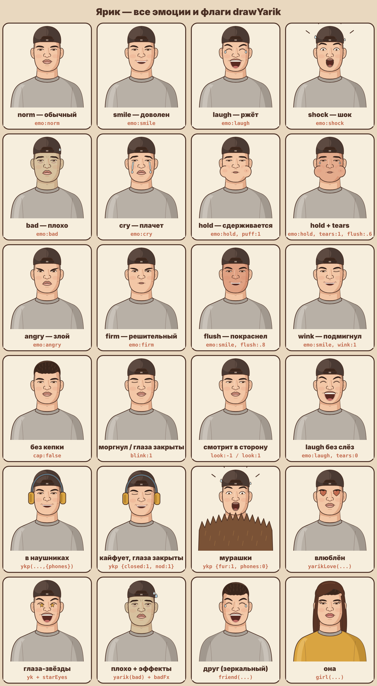
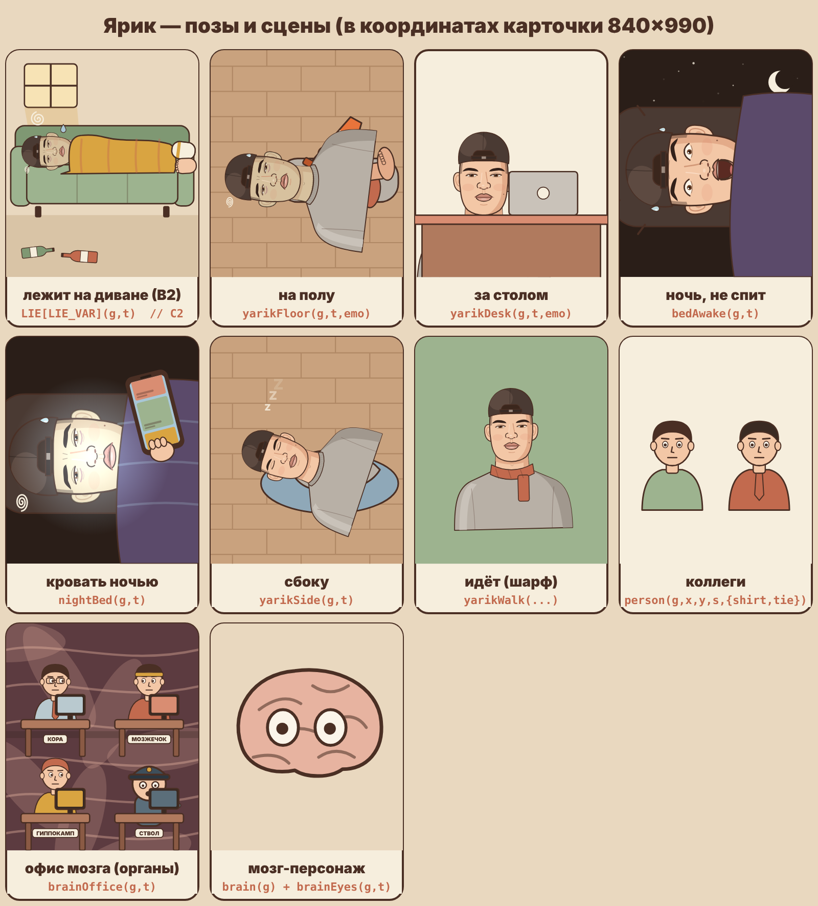

# Ярик: внешность во всех состояниях

Утверждён автором 2026-10-27 («Класс»). Код: `scripts/engine/yarik.js`, функция `drawYarik(g,{...})`. Листы с картинками:

- `assets/yarik-emotsii.png` — все эмоции и флаги;
- `assets/yarik-pozy.png` — позы и сцены (лежит, на полу, за столом, ночью, идёт), органы-персонажи.

Рисуй Ярика **только этим кодом**, не перерисовывай заново и не «улучшай». Реалистичную версию по фото и версию v2 (белая рубашка-стойка) автор отверг.

## Постоянные черты

- Плоский 2D, шоколадные контуры `#4A2F24`, без Pixar и без реализма.
- Кепка козырьком назад (по умолчанию). Без кепки (`cap:false`) — французский кроп с высоким фейдом на висках, волосы `#3A261C`.
- Серый свитшот с рубчатым воротом `#B8B0A6`.
- Кожа персик `#F3C7A6`, румянец на щеках.
- Густые прямые тёмные брови низко над глазами, тяжёлое сонное веко, карие глаза `#6E4329`.
- Прямой нос с мягким кончиком, пухлые губы с ухмылкой на один бок, уши торчат, **родинка на правой щеке**.
- Говорит только диктор. Ярик не говорит, он играет ситуацию лицом и телом.

Система координат: (0,0) — центр лица. Глаза y≈-25, подбородок 224, макушка -265, свитшот до y=720. Ширина плеч ±430.

## Эмоции (`emo`)

| emo | Когда | Как выглядит |
| --- | --- | --- |
| `norm` | спокойно, слушает | губы «уточкой», сонное веко |
| `smile` | доволен, получилось | улыбка, брови чуть вверх |
| `laugh` | ржёт | глаза-дуги, рот открыт, по слезинке у щёк (`tears:0` убирает) |
| `shock` | шок, «ЧЁ?!» | брови вверх, глаза круглые, рот «О», две капли и черточки удивления вокруг головы |
| `bad` | плохо, похмелье, тошнит | зеленоватая кожа, мешки под глазами, капля пота, сливочная спираль головокружения слева сверху, морщины на лбу, без кепки волосы торчат |
| `cry` | плачет, жалко себя | брови домиком, ручьи слёз из-под глаз и капли (`tears:0..1` длина ручья). **Новая, добавлена 2026-11-02, покажи автору** |
| `hold` | сдерживается (смех, чих) | щёки надуты (`puff:0..1`), рот сжат; `tears:1` — выступили слёзы |
| `angry` | злой | брови сведены вниз к носу, рот вниз |
| `firm` | решительный, «всё, бросаю» | брови сдвинуты, губы сжаты |

## Флаги `drawYarik`

| Флаг | Что делает |
| --- | --- |
| `cap:false` | без кепки |
| `blink:0..1` | моргание (1 — глаза закрыты) |
| `look:-1..1` | взгляд влево/вправо |
| `flush:0..1` | лицо краснеет к терракоте (нагнетание, стыд, жар) |
| `puff:0..1` | надутые щёки (для `hold`) |
| `tears:0..1` | слёзы (для `laugh`, `hold`, `cry`) |
| `wink:true` | подмигивает правым глазом |

## Обёртки (что вызывать в сцене)

| Функция | Что даёт |
| --- | --- |
| `yarik(g,x,y,s,emo,t,{look,rot})` | покачивание + автоморгание |
| `yk(g,x,y,s,emo,t,o)` | то же + тряска `o.shake`, все флаги drawYarik прокидываются (`flush`, `puff`, `tears`, `wink`...) |
| `ykp(g,x,y,s,emo,t,o)` | наушники (по умолчанию; `phones:0` убирает, `glow` подсветка), кивает в бит `nod:1`, глаза закрыты `closed:1`, мурашки-шуба `fur:0..1` |
| `yarikWalk(g,x,y,s,emo,t)` | идёт с покачиванием, шарф |
| `yarikLove(g,x,y,s,t,hk)` | глаза-сердечки |
| `starEyes(g,t)` | глаза-звёзды (внутри `at(...)` поверх drawYarik), NZT |
| `badFx(g,x,y,s,t)` | спираль + капля пота рядом с головой |
| `eyesShut(g,x,y,s,tilt)` | закрытые глаза поверх (спит) |
| `zzz(g,t,x,y)` | «Z z z» |

Масштаб `s`: 0.36 — портрет в маленькой ячейке; 0.6–0.7 — по пояс в карточке; 1.1–1.5 — крупно лицо (хук, нагнетание); 2+ — экстремальный зум в лицо.

## Позы и сцены (координаты карточки 840×990)

| Функция | Сцена |
| --- | --- |
| `LIE[LIE_VAR](g,t)`, `LIE_VAR='C2'` (`lie.js`) | лежит пластом на длинном диване, плед до шеи, одна нога в носке, другая босая, бутылки на полу. Вариант В2 утверждён 2026-10-28 |
| `yarikFlat(g,emo,t)` | сам Ярик лёжа на спине (для своих сцен лёжа) |
| `yarikHeadLying(...)` | голова на подушке крупно |
| `yarikFloor(g,t,emo)` | проснулся на полу (с конусом) |
| `yarikSide(g,t,o)` | спит на боку на полу, `o.dark` ночь |
| `yarikDesk(g,t,emo,o)` | за столом с ноутбуком |
| `nightBed(g,t,o)` | ночь в кровати, лицо в свете телефона |
| `bedAwake(g,t)` | ночь, не спит, глаза открыты, звёзды и луна |
| `bedScene(g,t,ph)` | кровать по фазам |

Ночь рисуем синей/фиолетовой, не чёрной.

## Второстепенные персонажи

| Функция | Кто |
| --- | --- |
| `friend(g,x,y,s,emo,t)` | друг: зеркальный Ярик без кепки |
| `girl(g,x,y,s,t,o)` | «она»: длинные волосы, горчичный свитер |
| `person(g,x,y,s,{shirt,hair,tie,look,turn,glasses,tilt})` | коллеги, толпа (`crowd`) |
| `granny`, `neighbor`, `courier`, `pharm`, `guard` | бабушка из маршрутки, сосед, курьер, фармацевт, охранник |

Повторяющихся персонажей рисуем одинаково из серии в серию и возвращаем в финале.

## Органы и отделы мозга как персонажи

Разрешено с серий 13–15 (автор сам ввёл). Не говорят, играют.

| Функция | Кто |
| --- | --- |
| `brainOffice(g,t,o)` | мозг-офис: все четыре отдела за столами с табличками |
| `kora(g,x,y,s,t,st)` | **Кора** (лобная доля): начальник в очках и галстуке; `st=1` ослабил галстук, `st=2` спит лицом в клавиатуре |
| `cereb(g,x,y,s,t,o)` | **Мозжечок**: спортсмен с повязкой (на канате, падает) |
| `hippo(g,x,y,s,t,on)` | **Гиппокамп**: с камерой, `on=0` камера гаснет |
| `guard(g,t,press)` | **Ствол мозга**: охранник, пот, мигающая лампа |
| `brain(g,col)` + `brainEyes(g,t,wide)` | мозг с глазами |
| `brainMap(g,t,hi)`, `brainIn(g,t,dark)` | карта отделов с подсветкой, фон «внутри мозга» |
| `neuron(g,t,o)` | нейрон-работяга |
| `stomach`, `liver`, `kidney`, `lungs`, `heart`, `vessel`, `adrenal`, `pancreas` | органы в нашем стиле |

Анатомия верная: отдел стоит там, где он на самом деле.

## Карусели Threads и Telegram

В каруселях (`/mnt/project-files/yarik/karusel-brosil-kurit/src/lib/`) тот же `drawYarik`, плюс обёртка `Y(g,x,y,s,emo,gray,pink)`: `gray` — серый фильтр (Ярик «до»), `pink` — розовые щёки.

## Как показать новую эмоцию

Новую эмоцию добавляй строкой в таблицу `E` в `yarik.js` (`bIn`, `bOut`, `bArch` брови, `lid` веко, `low` нижнее веко, `mouth`: `pout|frown|open|laugh|press|smile`) и рисуй её на листе: `node emosheet.js . sheet.png faces` (после `./build.sh`). Покажи автору до монтажа.
