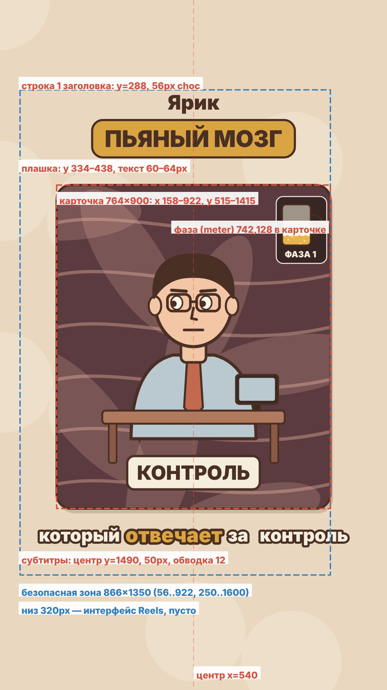

# Раскладка кадра: где что стоит

Картинка с разметкой: `assets/raskladka.jpg`. Всё ниже взято из рабочего кода серий 11–15 (`scripts/engine/tail.part`, `lib.part`, `ep13helpers.part`) и утверждено автором. Не двигай без его просьбы.



## Кадр и безопасная зона

- Кадр 1080×1920, 30 fps.
- Безопасная зона Reels 866×1350: x 56..922, y 250..1600. Всё важное только внутри.
- Отступы: верх 250, низ 320 (там ник, описание, панель Reels), право 158 (кнопки лайк/коммент/репост), лево 56.
- Всё центруем по **центру экрана x=540**, а не по центру зелёной рамки. Это решение автора: «окошко и заголовок по центру экрана».

## Фон страницы

Тёплый беж `#E9D8BF` + 9 мягких белых кругов (боке). Висит весь ролик, за карточкой.

## Заголовок (висит весь ролик)

Функция `title(g)` в `tail.part`.

| Что | Координаты | Шрифт и цвет |
| --- | --- | --- |
| Строка 1 («Ярик» или «Почему ты хрюкаешь,») | центр x=540, y=288 | Inter 900, 56 px, шоколад `#4A2F24` |
| Плашка | `rr(CX-w/2, 334, w, 104, 30)`, w = ширина текста + 60…70 | заливка горчица `#D9A441`, обводка шоколад 6 |
| Текст плашки («ПЬЯНЫЙ МОЗГ», «NZT-48», «КОГДА СМЕЁШЬСЯ») | центр x=540, y=390 | Inter 900, 60–64 px, шоколад, капсом |

- Заголовок поднят, между плашкой (низ 438) и карточкой (верх 515) зазор ~77 px. Автор просил «заголовок выше, с отступом от окошка».
- Формат с серии 11: строка 1 = «Ярик» или начало вопроса, плашка = ключевое слово капсом.
- Ранние серии (1–10) были с терракотовой плашкой и сливочным текстом (серия 9 фиолетовая `#6A4C9C`). Сейчас стандарт горчица + шоколад.
- Если на плашку ставишь иконку (Telegram и т.п.), делай плашку шире, чтобы иконка не наезжала на букву (было: иконка залезала на «Ч»).

## Карточка-сцена (окошко)

`CX=540, CARD={y:515, w:840, h:990, r:44, k:764/840}`.

- Сцена рисуется в локальных координатах **840×990**, потом масштаб 0.9095 → на экране **764×900**: x 158..922, y 515..1415.
- Скругление 44, обводка шоколад 7, тень `rgba(74,47,36,.18)` со сдвигом (8,14).
- Появление сцены: масштаб 0.94 → 1 за 0.18 сек.
- Тёмный фон сцены получает виньетку. Поле сцены `lux:1` — сливочные лучи (откровение), `lux:2` — горчичные лучи (лайфхак, «свершилось»).
- Внутри карточки на склейке: вспышка 0.09 сек, наезд камеры за 0.22 сек (`zoom` по умолчанию 1.16), speedLines.

## Элементы внутри карточки (координаты 840×990)

| Элемент | Функция | Где обычно |
| --- | --- | --- |
| Штамп блока («ЧТО ВЧЕРА БЫЛО?», «ФАЗА 2») | `stamp(g,s,x,y,col,t,st,rot=-.12,size=58)` | сверху (420,150) или по центру; влетает с масштаба 2.2, двойная рамка |
| Плашка ключевого слова («КОНТРОЛЬ», «−3000 ₽») | `plaque(g,s,col=P.mustard,size=54,tc=P.choc)` внутри `at(...)` | сверху (420,120…160) или снизу (380…420,860) |
| Крупная цифра | `bigNum(g,s,x,y,col,t,st,size=96)` | где цифра по смыслу |
| Бирка / табло | `tag`, `digital` | возле предмета |
| Шкала | `gauge(g,k,label)`, `dopaBar(g,k,label)`, `vbar`, `battery`, `tank` | сбоку или снизу |
| Индикатор фазы (пивной бокал) | `meter(g,n,t,red)` | правый верх карточки (742,128), масштаб 0.62; заполнен на n/3, на фазе 3 мигает красным |
| Вопросы, искры, лучи | `qmark`, `sparks`, `rays`, `confetti` | вокруг героя |

Плашки и штампы не перекрывают лицо Ярика. Плашка снизу карточки не залезает на субтитры (низ карточки 1415, субтитры с ~1450).

## Субтитры (вариант 3, утверждён)

Функция `subtitle(g,sub,lt)` в `tail.part`, `SUB_STYLE='outline'`, `SUB_Y=1490`.

- Без плашки. Слова сливочно-белые `#F6EEDD` с толстой шоколадной обводкой (`lineWidth=12`, `lineJoin` round), шрифт Inter 900, 50 px.
- Текущее слово горчичное `#D9A441` и крупнее: масштаб 1 + 0.14·k, k нарастает за 0.12 сек.
- Строка по центру экрана x=540, центр по вертикали y=1490 (над карточкой не впритык, чуть выше низа рамки).
- Расстояние между словами = ширина пробела + 22.
- Кусок 2–4 слова или до ~20 знаков, режем по знакам препинания.
- **Ширина строки до 760 px, правый край не дальше 922.** Проверяй глазами: длинные слова с подсветкой («который отвечает за контроль») вылезают за 922. Такой кусок режь на два.
- После конца речи в сцене (`subEnd`) субтитр прячется.
- Аудиотеги `[...]` и знаки ударения в субтитры не попадают (`clean()` в `tail.part`).
- Токен `@CAT` в тексте рисует трёх котиков вместо слов (так в субтитрах заменили «зависимого человека»).

## Палитра

```
P={beige:'#E9D8BF', cream:'#F6EEDD', peach:'#F3C7A6', terra:'#C26A4E', sage:'#9DB38F',
   mustard:'#D9A441', choc:'#4A2F24', dark:'#3A2A22', darker:'#2A1E18', sageD:'#7F9873', terraL:'#D98D72'}
```

Шрифт один: Inter 900 и 800.

## Обложка (`cover.js`)

1080×1920, всё главное в центральной зоне 1080×1350 (y 285..1635). Одна обложка, заголовок = название идеи. Рендер: `node cover_render.js <outdir>`.
