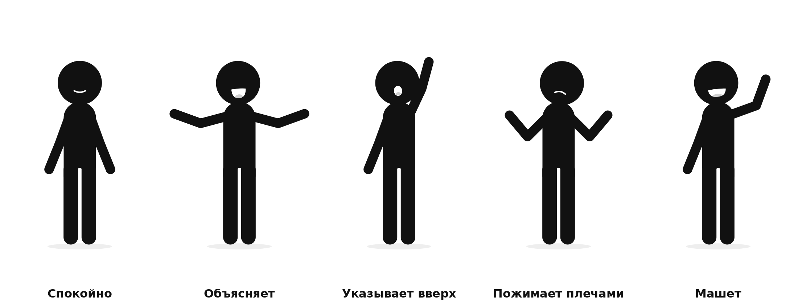
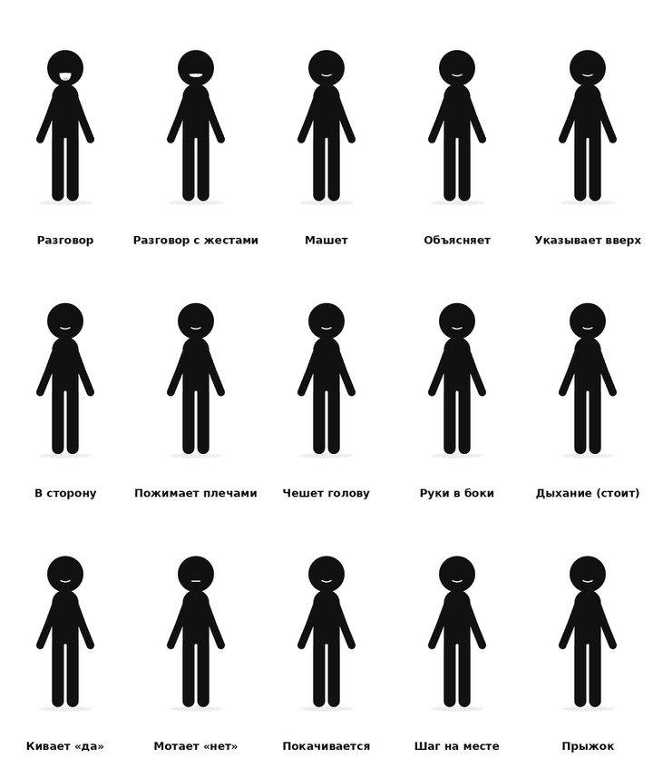

# Человечек «Не тупи»

Главный герой канала «Не тупи». Белый фон, чёрный сглаженный человечек: тело одним столбиком одной ширины от плеч до пят, ноги отделены только щелью, руки от плеч без видимых плеч и заканчиваются полукругом (без кистей и пальцев). Из деталей только рот.





## Что здесь

- `rig.py` — человечек кодом (Python → SVG). Поза задаётся параметрами: углы рук и ног, наклон корпуса, голова, приседание, подъём ноги, форма рта. Кадр 1080×1920 (9:16).
- `anim.py` — 15 анимаций на ключевых кадрах, 24 кадра в секунду. Пишет кадры PNG, GIF и MP4.
- `grid.py` — общий превью-ролик со всеми анимациями.
- `koncept/` — утверждённый концепт: человечек в кадре и лист поз.
- `animacii/` — готовые GIF и MP4 по каждой анимации и общий превью.

## Анимации

| Группа | Имя | Что делает |
|---|---|---|
| Разговор | `razgovor` | говорит, руки спокойно |
| | `razgovor-zhesty` | говорит и объясняет руками |
| Жесты | `mashet` | машет |
| | `obyasnyaet` | разводит руками, объясняет |
| | `ukazyvaet-vverh` | указывает вверх |
| | `ukazyvaet-vbok` | показывает в сторону (место под текст или картинку) |
| | `pozhimaet-plechami` | пожимает плечами |
| | `cheshet-golovu` | чешет голову |
| | `ruki-v-boki` | руки в боки |
| Движения | `dyhanie` | стоит и дышит |
| | `kivok` | кивает «да» |
| | `net` | мотает «нет» |
| | `pokachivanie` | покачивается |
| | `shag` | шаг на месте |
| | `pryzhok` | прыжок |

## Формы рта

`rest` (покой), `M` (М/Б/П), `A`, `E` (Э/И), `O`, `U`, `smile`, `sad`, `wow`. Сейчас в разговоре рот меняется случайно. Под озвучку ElevenLabs формы будут браться из таймингов фонем.

## Как запустить

```bash
pip install cairosvg            # плюс ffmpeg в системе
python3 ne-tupi/chelovechek/anim.py out              # все анимации
python3 ne-tupi/chelovechek/anim.py out kivok mashet # только выбранные
python3 ne-tupi/chelovechek/grid.py out              # общий превью (после anim.py)
```

Кадры 1080×1920 появятся в `out/kadry/<имя>/`, гифки в `out/gif/`, ролики в `out/mp4/`. Кадры в репозиторий не кладём, они собираются за минуту.
